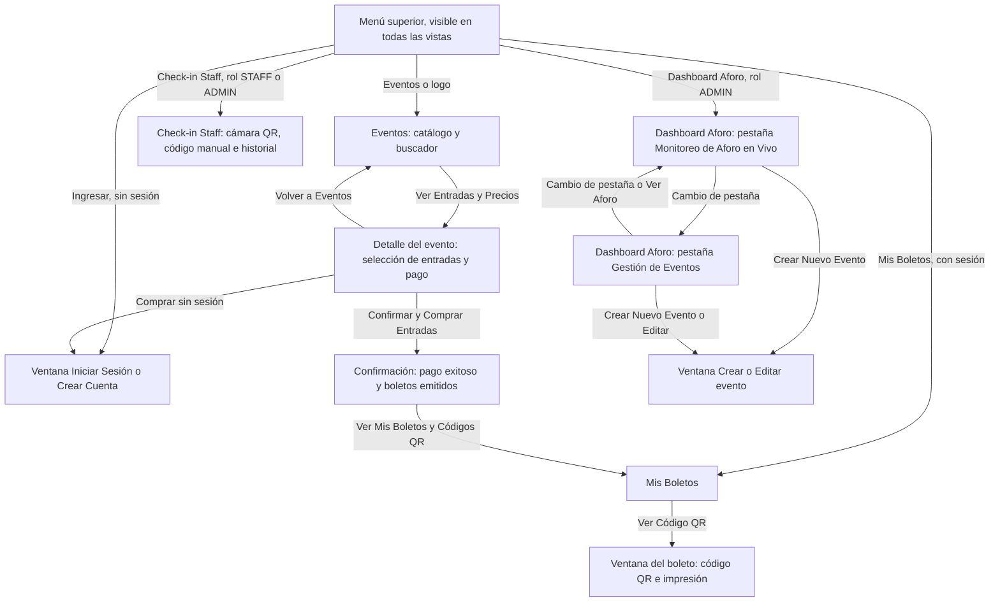

# PassMaster - Sistema de Ticketing y Acceso a Eventos

Aplicación web para crear eventos, vender boletos digitales y validar el ingreso de los asistentes, con monitoreo del aforo desde un panel administrativo.

El frontend está hecho en React (Vite y Tailwind CSS) y el backend en Node.js con Express, organizado en MVC, sobre una base de datos MySQL 8.0.

## Cumplimiento de Especificaciones

| Requerimiento | Implementación en PassMaster |
| :--- | :--- |
| Frontend con dashboard de aforo | Panel administrativo en React que consulta el aforo del evento cada 5 segundos: capacidad, entradas vendidas, ingresos registrados y porcentaje de ocupación. |
| Backend con códigos únicos | Servidor Node.js con Express en arquitectura MVC: modelos (`src/models`), rutas (`src/routes`), controladores (`src/controllers`) y servicios (`src/services`). Cada boleto recibe un código con formato `TKT-XXXXXXXX-XXXXXXXX` y la base de datos impide que se repita. |
| Base de datos y transacciones | MySQL 8.0. La compra se ejecuta en una transacción con bloqueo de filas (`SELECT ... FOR UPDATE`) para que no se vendan más entradas que los cupos disponibles. |
| Tickets con identificador único | Tras la compra se emite un boleto por entrada, con su código único y una firma HMAC-SHA256 que viaja en el código QR. |
| Módulo de check-in | Pantalla para el personal con lectura del QR por cámara o ingreso manual del código. Valida el estado del boleto (`ACTIVE`, `CHECKED_IN`, `CANCELLED`) y rechaza el reingreso. |
| Pasarela de pagos | Flujo de pago en modo sandbox: el servidor valida el número de tarjeta, la fecha de expiración y el CVV, aprueba las tarjetas válidas y rechaza las tarjetas de prueba de rechazo. No se hace ningún cobro real ni se guardan los datos de la tarjeta. El servicio incluye la integración con Stripe, que se activa al configurar una clave en el servidor. |
| Seguridad | Autenticación con JWT, contraseñas cifradas con bcrypt, control de acceso por rol, validación de entradas, límite de peticiones, cabeceras de seguridad y base de datos con usuario de permisos mínimos. El detalle está en la sección Seguridad. |
| Documentación | API, mapa de navegación y guía de usuario en este mismo documento. También hay una copia en [api-spec.md](docs/api-spec.md), [navigation-map.md](docs/navigation-map.md) y [user-guide.md](docs/user-guide.md). |

## Estructura del Repositorio

```
docker-compose.yml           Levanta base de datos, backend y frontend
backend/
    Dockerfile
    package.json
    .env.example             Variables de entorno de ejemplo
    database/
        schema.sql           Creación de la base de datos y sus tablas
        seed.sql             Datos de demostración en SQL
    src/
        server.js            Punto de entrada de Express
        config/              Conexión a MySQL y verificación de secretos
        controllers/         Auth, eventos, órdenes, tickets y check-in
        middlewares/         Verificación de JWT y de roles
        models/              Consultas SQL por entidad
        routes/              Rutas de la API
        services/            Compra de tickets, pagos y generación de QR
        utils/               Migración, seed, firma HMAC y validación de entradas
    test/                    Pruebas de la validación de pagos
frontend/
    Dockerfile
    nginx.conf               Sirve la web y reenvía /api al backend
    package.json
    index.html
    src/
        App.jsx              Vistas de la aplicación
        api/                 Cliente HTTP
        components/          Menú superior y ventana modal
        context/             Sesión del usuario
        pages/               Catálogo, detalle y compra, mis boletos, dashboard y check-in
docs/
    api-spec.md
    navigation-map.md
    user-guide.md
```

## Instalación y Uso con Docker

Requisitos: Git y Docker con Docker Compose.

1. Clonar el repositorio en la carpeta actual. La carpeta debe estar vacía; el punto final indica que se clone ahí mismo y no en una subcarpeta:
```bash
git clone https://github.com/elputiciero2/passmaster .
```
Si se prefiere que Git cree la carpeta:
```bash
git clone https://github.com/elputiciero2/passmaster
cd passmaster
```

2. Elegir la rama. `main` es la versión base y `main-modoseguro` (esta) es la versión con las medidas de seguridad:
```bash
git checkout main-modoseguro
```

3. Levantar el sistema completo:
```bash
docker compose up --build
```
Ese comando levanta MySQL, crea las tablas, carga los datos de demostración e inicia el backend y el frontend. La primera vez tarda unos minutos porque descarga y construye las imágenes.

4. Abrir la aplicación e iniciar sesión con una de las cuentas de demostración que aparecen más abajo:
- Aplicación web: http://localhost:8080
- API: http://localhost:8080/api. El backend y la base de datos no publican puertos: solo se llega a ellos a través de la web.

Comandos de uso diario:

| Acción | Comando |
| :--- | :--- |
| Levantar en segundo plano | `docker compose up --build -d` |
| Ver el estado de los contenedores | `docker compose ps` |
| Ver los registros del backend | `docker compose logs -f backend` |
| Detener el sistema, conservando los datos | `docker compose down` |
| Detener y borrar la base de datos | `docker compose down -v` |
| Actualizar el código | `git pull` y luego `docker compose up --build` |

Al cambiar de una rama a otra hay que reiniciar la base de datos, porque cada rama la configura distinto:
```bash
docker compose down -v
git checkout main
docker compose up --build
```

## Puesta en Marcha Manual (sin Docker)

Requiere Node.js 18 o superior y un servidor MySQL 8.0 en el puerto 3306.

Backend:
```bash
cd backend
npm install
cp .env.example .env    # ajustar MySQL; JWT_SECRET y QR_HMAC_SECRET son obligatorios (32 caracteres o más)
npm run migrate         # crea la base de datos passmaster_db y sus tablas
npm run seed            # carga usuarios y eventos de demostración
npm test                # pruebas de la validación de pagos
npm run dev             # API en http://localhost:5000/api
```

Frontend, en otra terminal:
```bash
cd frontend
npm install
npm run dev             # aplicación en http://localhost:5173
```

## Cuentas de Demostración

| Rol | Correo | Contraseña | Qué puede hacer |
| :--- | :--- | :--- | :--- |
| Administrador | `admin@passmaster.com` | `Password123!` | Ver el aforo, crear, editar y eliminar eventos, hacer check-in y comprar. |
| Staff | `staff@passmaster.com` | `Password123!` | Validar boletos en el check-in y comprar. |
| Comprador | `cliente@passmaster.com` | `Password123!` | Comprar entradas y ver sus boletos con código QR. |

## Documentación de la API (Endpoints)

- URL base: `http://localhost:8080/api` con Docker, o `http://localhost:5000/api` en la ejecución manual
- Formato: `application/json` en peticiones y respuestas
- Autenticación: encabezado `Authorization: Bearer <token>`; el token se obtiene en `/auth/login` o `/auth/register` y dura 7 días
- Roles: `ADMIN`, `STAFF`, `CUSTOMER`

Todas las respuestas tienen la forma `{ "success": true|false, "message": "...", "data": ... }`.

### Resumen de endpoints

| Método | Ruta | Acceso | Descripción |
| :--- | :--- | :--- | :--- |
| `GET` | `/health` | Público | Estado del servidor |
| `POST` | `/auth/register` | Público | Registrar usuario |
| `POST` | `/auth/login` | Público | Iniciar sesión y obtener token |
| `GET` | `/auth/me` | Token | Datos del usuario autenticado |
| `GET` | `/events` | Público | Listar eventos publicados (todos, con token de `ADMIN` o `STAFF`) |
| `GET` | `/events/:id` | Público | Detalle de un evento con sus localidades |
| `GET` | `/events/:id/occupancy` | `ADMIN`, `STAFF` | Aforo en tiempo real |
| `POST` | `/events` | `ADMIN` | Crear evento |
| `PUT` | `/events/:id` | `ADMIN` | Editar evento y localidades |
| `DELETE` | `/events/:id` | `ADMIN` | Eliminar evento |
| `POST` | `/orders/checkout` | Token | Comprar entradas (pago + emisión de tickets) |
| `GET` | `/orders/my-orders` | Token | Órdenes del usuario autenticado |
| `GET` | `/orders/:id` | Dueño o `ADMIN` | Detalle de una orden con sus tickets |
| `GET` | `/orders` | `ADMIN` | Todas las órdenes del sistema |
| `GET` | `/tickets/my-tickets` | Token | Boletos del usuario autenticado |
| `GET` | `/tickets/:id` | Dueño o `ADMIN` | Boleto con imagen QR |
| `POST` | `/checkin/verify` | `STAFF`, `ADMIN` | Validar boleto y registrar ingreso |
| `GET` | `/checkin/logs/:eventId` | `STAFF`, `ADMIN` | Historial de escaneos de un evento |

### Errores comunes

| Código | Cuándo ocurre |
| :--- | :--- |
| `400` | Faltan campos obligatorios o la compra no se puede procesar |
| `401` | Falta el token, tiene mal formato, expiró o las credenciales son inválidas |
| `403` | El rol del usuario no tiene permiso sobre el recurso |
| `404` | El recurso no existe |
| `409` | Correo ya registrado, boleto ya utilizado o evento con boletos vendidos |
| `429` | Se superó el límite de peticiones; hay que esperar antes de reintentar |
| `500` | Error interno; el detalle queda en los registros del servidor y no se envía al cliente |

### 1. Autenticación (`/auth`)

#### `POST /auth/register`
Crea una cuenta de comprador y devuelve su token. El rol siempre es `CUSTOMER`: las cuentas de Staff y Administrador no se pueden crear por la API. La contraseña debe tener entre 8 y 72 caracteres.
```json
{ "name": "Juan Pérez", "email": "juan@example.com", "password": "Password123!" }
```
Respuesta `201`:
```json
{
  "success": true,
  "message": "Usuario registrado exitosamente.",
  "data": {
    "user": { "id": 4, "name": "Juan Pérez", "email": "juan@example.com", "role": "CUSTOMER" },
    "token": "eyJhbGciOiJIUzI1NiIs..."
  }
}
```
Errores: `400` si el nombre, el correo o la contraseña no son válidos; `409` si el correo ya existe; `429` tras 10 registros por hora desde la misma dirección.

#### `POST /auth/login`
```json
{ "email": "admin@passmaster.com", "password": "Password123!" }
```
Respuesta `200`: misma estructura que el registro (`data.user` y `data.token`). Error `401` si las credenciales son inválidas; `429` tras 10 intentos fallidos en 15 minutos.

#### `GET /auth/me`
Devuelve `data.user` del token enviado.

### 2. Eventos y aforo (`/events`)

#### `GET /events`
Parámetro opcional `search` (busca en título y ubicación). Sin token, o con un token de comprador, solo devuelve eventos publicados. Con token de `ADMIN` o `STAFF` devuelve todos y acepta además `status` (`DRAFT`, `PUBLISHED`, `FINISHED`, `CANCELLED`). Los eventos vienen ordenados por fecha.
```json
{
  "success": true,
  "data": [
    {
      "id": 1,
      "title": "TechFest Global Summit 2026",
      "description": "El mayor evento de tecnología...",
      "location": "Centro de Convenciones Metropolitano - Gran Salón A",
      "event_date": "2026-12-15T09:00:00.000Z",
      "banner_url": "https://...",
      "max_capacity": 500,
      "status": "PUBLISHED",
      "creator_name": "Administrador PassMaster",
      "configured_capacity": "500",
      "available_capacity": "499",
      "sold_tickets": "1"
    }
  ]
}
```

#### `GET /events/:id`
Devuelve el evento con el arreglo `tiers` (localidades), ordenado por precio. Un evento no publicado responde `404` salvo para `ADMIN` y `STAFF`.
```json
{
  "success": true,
  "data": {
    "id": 1,
    "title": "TechFest Global Summit 2026",
    "tiers": [
      { "id": 3, "name": "Early Bird Estudiante", "price": "25.00", "total_quantity": 50, "available_quantity": 50 },
      { "id": 1, "name": "Entrada General", "price": "45.00", "total_quantity": 350, "available_quantity": 349 }
    ]
  }
}
```

#### `GET /events/:id/occupancy`
Datos que alimentan el dashboard de aforo. `occupancy_percentage` son los ingresos físicos sobre la capacidad; `sales_percentage`, las entradas vendidas sobre la capacidad.
```json
{
  "success": true,
  "data": {
    "event_id": 1,
    "title": "TechFest Global Summit 2026",
    "max_capacity": 500,
    "total_configured": "500",
    "total_sold": "410",
    "total_available": "90",
    "total_checked_in": 285,
    "effective_capacity": "500",
    "occupancy_percentage": 57,
    "sales_percentage": 82
  }
}
```

#### `POST /events`
Obligatorios: `title`, `location`, `event_date`. Si se omiten, `max_capacity` vale 100 y `status` vale `PUBLISHED`.
```json
{
  "title": "Festival de Jazz 2026",
  "description": "Concierto al aire libre",
  "location": "Parque Central",
  "event_date": "2026-12-20 18:00:00",
  "banner_url": "https://example.com/banner.jpg",
  "max_capacity": 200,
  "status": "PUBLISHED",
  "tiers": [
    { "name": "General", "price": 20.00, "total_quantity": 150 },
    { "name": "VIP", "price": 50.00, "total_quantity": 50 }
  ]
}
```
Respuesta `201`: el evento creado con sus `tiers`. Error `400` si algún campo no es válido: textos demasiado largos, fecha o estado inválidos, imagen que no sea una URL http o https, precio negativo o cupos que no sean enteros positivos.

#### `PUT /events/:id`
Acepta los mismos campos que la creación; los que no se envían conservan su valor. En `tiers`, una localidad con `id` se actualiza y una sin `id` se crea.
```json
{
  "title": "Festival de Jazz 2026 (nueva fecha)",
  "event_date": "2026-12-27 18:00:00",
  "tiers": [
    { "id": 6, "name": "General", "price": 25.00, "total_quantity": 150 },
    { "name": "Palco", "price": 80.00, "total_quantity": 20 }
  ]
}
```
La disponibilidad de cada localidad la calcula el servidor (cupos menos entradas vendidas). Respuesta `200`: el evento actualizado. Error `404` si no existe; `400` si una localidad no pertenece al evento o si sus cupos quedarían por debajo de lo ya vendido.

#### `DELETE /events/:id`
Elimina el evento y sus localidades. Respuesta `200` con `"Evento eliminado exitosamente."`; `404` si no existe. Un evento con boletos ya vendidos no se puede eliminar y la API responde `409`.

### 3. Órdenes y pasarela de pagos (`/orders`)

#### `POST /orders/checkout`
Ejecuta la compra completa en una sola transacción: bloquea los cupos, cobra en la pasarela, crea la orden, descuenta disponibilidad y emite un ticket con código único por cada entrada. Si algo falla, no se guarda nada.
```json
{
  "items": [ { "tierId": 1, "quantity": 2 } ],
  "paymentInfo": {
    "card": { "number": "4242 4242 4242 4242", "holder": "Juan Pérez", "expDate": "12/30", "cvv": "123" }
  }
}
```
Se aceptan hasta 10 localidades distintas por compra y hasta 10 entradas de cada una.

La pasarela funciona en modo sandbox (`MOCK_SANDBOX`). Comprueba que el número de tarjeta sea válido, que la fecha (`MM/AA`) no esté vencida y que el CVV tenga 3 o 4 dígitos. Los datos de la tarjeta no se guardan ni se registran. Tarjetas de prueba:

| Número | Resultado |
| :--- | :--- |
| `4242 4242 4242 4242` | Pago aprobado |
| `4000 0000 0000 0002` | Rechazada por el banco emisor |
| `4000 0000 0000 9995` | Fondos insuficientes |
| `4000 0000 0000 0069` | Tarjeta vencida |
 Si el servidor tiene configurada una clave real de Stripe y se envía `paymentInfo.token`, el cobro se hace con Stripe.

Respuesta `201`:
```json
{
  "success": true,
  "message": "¡Compra procesada y tickets generados exitosamente!",
  "data": {
    "success": true,
    "orderId": 12,
    "orderNumber": "PM-05FAB000B45A",
    "totalAmount": 90,
    "gateway": "MOCK_SANDBOX",
    "tickets": [
      { "id": 25, "ticketCode": "TKT-5102C579-AAC63B24", "tierName": "Entrada General", "price": "45.00", "eventTitle": "TechFest Global Summit 2026" },
      { "id": 26, "ticketCode": "TKT-91B0C3AA-7D2E44F1", "tierName": "Entrada General", "price": "45.00", "eventTitle": "TechFest Global Summit 2026" }
    ]
  }
}
```
Error `400` con el motivo en `message`: cantidades inválidas, localidad repetida o inexistente, evento no publicado, cupo insuficiente, datos de tarjeta inválidos o pago rechazado. Error `429` tras 30 intentos de compra en 15 minutos.

#### `GET /orders/my-orders`
Órdenes del usuario autenticado, de la más reciente a la más antigua.
```json
{
  "success": true,
  "data": [
    {
      "id": 12,
      "order_number": "PM-05FAB000B45A",
      "user_id": 3,
      "total_amount": "90.00",
      "payment_gateway": "MOCK_SANDBOX",
      "payment_intent_id": "pi_mock_3f9a1c0b7e5d2a4c6b8d0e1f",
      "payment_status": "COMPLETED",
      "created_at": "2026-11-13T04:57:00.000Z",
      "ticket_count": 2
    }
  ]
}
```

#### `GET /orders/:id`
Detalle de una orden con `user_name`, `user_email` y el arreglo `tickets`. Solo la puede ver su dueño o un `ADMIN`; cualquier otro usuario recibe `403`. Error `404` si no existe.

#### `GET /orders`
Todas las órdenes del sistema, con la misma estructura que `/orders/my-orders` más `user_name` y `user_email` del comprador.

### 4. Tickets y códigos QR (`/tickets`)

#### `GET /tickets/my-tickets`
Boletos del usuario autenticado con los datos del evento y la localidad. `status` puede ser `ACTIVE`, `CHECKED_IN` o `CANCELLED`.
```json
{
  "success": true,
  "data": [
    {
      "id": 25,
      "order_id": 12,
      "ticket_code": "TKT-5102C579-AAC63B24",
      "status": "ACTIVE",
      "checked_in_at": null,
      "tier_name": "Entrada General",
      "tier_price": "45.00",
      "event_id": 1,
      "event_title": "TechFest Global Summit 2026",
      "event_location": "Centro de Convenciones Metropolitano - Gran Salón A",
      "event_date": "2026-12-15T09:00:00.000Z",
      "order_number": "PM-05FAB000B45A"
    }
  ]
}
```

#### `GET /tickets/:id`
Mismo boleto más `buyer_name`, `buyer_email` y `qr_image`: la imagen del código QR en base64 (`data:image/png;base64,...`), lista para mostrarse en una etiqueta ``. Solo lo puede consultar su comprador o un `ADMIN`, porque el QR contiene la firma del boleto. Error `403` para cualquier otro usuario, incluido el Staff; `404` si no existe.

### 5. Check-in y control de acceso (`/checkin`)

#### `POST /checkin/verify`
Valida un boleto y, si está activo, lo marca como ingresado. `qrData` es el contenido leído del QR o, para el ingreso manual, solo el código del boleto. `eventId` y `deviceInfo` son opcionales.
```json
{
  "qrData": "{\"app\":\"PASSMASTER\",\"code\":\"TKT-5102C579-AAC63B24\",\"sig\":\"d04d4c71...\"}",
  "eventId": 1,
  "deviceInfo": "Móvil Puerta Norte"
}
```
El campo `result` de la respuesta indica el veredicto:

| HTTP | `result` | Significado |
| :--- | :--- | :--- |
| `200` | `SUCCESS` | Acceso autorizado; el boleto pasa de `ACTIVE` a `CHECKED_IN` |
| `409` | `ALREADY_USED` | El boleto ya ingresó; se devuelve la fecha del primer ingreso |
| `400` | `CANCELLED` | El boleto está cancelado o reembolsado |
| `400` | `WRONG_EVENT` | El boleto pertenece a otro evento |
| `400` | `COUNTERFEIT_ALERT` | La firma digital del QR no es válida |
| `400` | `INVALID` | No se envió `qrData` o el QR no tiene el formato esperado |
| `404` | `INVALID` | El código no existe |

Cada intento sobre un boleto existente queda registrado en el historial. La transición a `CHECKED_IN` es atómica: si el mismo boleto se escanea a la vez en dos puertas, solo una recibe `SUCCESS`. El límite es de 60 validaciones por minuto.

#### `GET /checkin/logs/:eventId`
Últimos 50 escaneos del evento, del más reciente al más antiguo.
```json
{
  "success": true,
  "data": [
    {
      "id": 2,
      "ticket_id": 25,
      "scanned_by_user_id": 2,
      "scan_timestamp": "2026-12-15T09:12:00.000Z",
      "result": "ALREADY_USED",
      "device_info": "Web Scanner",
      "ticket_code": "TKT-5102C579-AAC63B24",
      "tier_name": "Entrada General",
      "staff_name": "Personal Check-in Acceso A",
      "event_title": "TechFest Global Summit 2026"
    }
  ]
}
```

## Mapa de Navegación

PassMaster es una aplicación de una sola página. No tiene rutas: la dirección del navegador no cambia, y lo que cambia es la vista que se muestra. La aplicación abre siempre en el catálogo de eventos y el menú superior, visible en todas las vistas, muestra las opciones según el rol de la sesión.



Cada nodo del diagrama corresponde a un archivo del frontend:

| Vista | Archivo | Se llega desde |
| :--- | :--- | :--- |
| Menú superior | `frontend/src/components/Navbar.jsx` | Siempre visible |
| Eventos | `frontend/src/pages/CatalogPage.jsx` | Vista inicial, botón Eventos o logo |
| Detalle del evento, pago y confirmación | `frontend/src/pages/EventDetailPage.jsx` | Botón Ver Entradas y Precios de un evento |
| Ventana de sesión | `frontend/src/pages/AuthModal.jsx` | Botón Ingresar, o al intentar comprar sin sesión |
| Mis Boletos y ventana del boleto | `frontend/src/pages/MyTicketsPage.jsx` | Menú, o al terminar una compra |
| Check-in Staff | `frontend/src/pages/StaffScannerPage.jsx` | Menú, con rol STAFF o ADMIN |
| Dashboard Aforo y ventana de evento | `frontend/src/pages/AdminDashboardPage.jsx` | Menú, con rol ADMIN |

La ventana de sesión se abre encima de la vista actual; al iniciar sesión o registrarse se cierra y el usuario permanece en la misma vista. Al cerrar sesión desaparecen del menú las opciones que dependen del rol.

### Vistas disponibles por rol

| Vista | Visitante | CUSTOMER | STAFF | ADMIN |
| :--- | :---: | :---: | :---: | :---: |
| Eventos (catálogo) | Sí | Sí | Sí | Sí |
| Detalle del evento | Sí | Sí | Sí | Sí |
| Comprar entradas | No | Sí | Sí | Sí |
| Mis Boletos | No | Sí | Sí | Sí |
| Check-in Staff | No | No | Sí | Sí |
| Dashboard Aforo | No | No | No | Sí |

### Flujos principales

Compra de entradas:
1. Eventos.
2. Detalle del evento, con la selección de entradas.
3. Inicio de sesión, si el usuario aún no tiene una sesión abierta.
4. Pago y confirmación.
5. Mis Boletos y ventana con el código QR.

Check-in:
1. Inicio de sesión con una cuenta de Staff o Administrador.
2. Check-in Staff y selección del evento.
3. Escaneo del QR o ingreso manual del código.
4. Resultado de la validación e historial de escaneos.

Administración:
1. Inicio de sesión con la cuenta de Administrador.
2. Dashboard Aforo, pestaña Monitoreo de Aforo en Vivo.
3. Pestaña Gestión de Eventos para crear, editar o eliminar eventos.

## Guía de Usuario

### Requisitos

- Con Docker: solo Docker con Docker Compose.
- Sin Docker: Node.js 18 o superior y MySQL 8.0.
- Un navegador moderno (Chrome, Firefox o Edge). El escáner necesita permiso de cámara, y los navegadores solo lo conceden en `localhost` o en sitios con HTTPS.

### Obtener y lanzar el proyecto

1. Clona el repositorio en una carpeta vacía: `git clone https://github.com/elputiciero2/passmaster .`
2. Levanta el sistema: `docker compose up --build`
3. Espera a que el backend indique que está en ejecución y abre `http://localhost:8080`.

El detalle de cada paso y los comandos para detener, reiniciar o cambiar de rama están en la sección "Instalación y Uso con Docker".

### Ingresar a la plataforma

1. Abre la aplicación (`http://localhost:8080` con Docker).
2. Pulsa **Ingresar** en la esquina superior derecha.
3. Inicia sesión con tu correo y contraseña, o cambia a registro para crear una cuenta de comprador. Las cuentas de Staff y Administrador no se crean desde el registro.

El catálogo de eventos se puede explorar sin iniciar sesión; para comprar sí hace falta una cuenta.

### Para el comprador

1. En **Eventos**, busca por título o ubicación y pulsa **Ver Entradas y Precios** en el evento que te interese.
2. En **1. Selecciona tus Entradas**, elige la cantidad de cada localidad. Las localidades sin cupo aparecen como **Agotado**.
3. En **2. Pago Seguro**, escribe los datos de la tarjeta, revisa el total y pulsa **Confirmar y Comprar Entradas**. La pasarela está en modo sandbox y no cobra nada real: el formulario viene con la tarjeta de prueba `4242 4242 4242 4242`, que se aprueba. Para ver un rechazo usa `4000 0000 0000 0002`; el motivo aparece en pantalla y no se emite ningún boleto.
4. Verás la confirmación con el total abonado y los códigos de tus boletos.
5. En **Mis Boletos**, pulsa **Ver Código QR** para abrir el boleto. Desde ahí puedes mostrarlo en el celular o usar **Imprimir Boleto Digital**.
6. Presenta el QR en la entrada del evento. Cada boleto sirve para un solo ingreso.

### Para el personal de check-in (Staff)

1. Inicia sesión con una cuenta de Staff y entra a **Check-in Staff**.
2. En **Puesto de Control para**, selecciona el evento que estás controlando.
3. Pulsa **Activar Cámara** y apunta al código QR del asistente. Si la cámara no está disponible, escribe el código del boleto (por ejemplo `TKT-5102C579-AAC63B24`) en el campo de ingreso manual.
4. Lee el veredicto:
   - Acceso autorizado: el boleto es válido y queda marcado como ingresado; se muestran los datos del asistente.
   - Boleto ya utilizado: ya se registró un ingreso con ese boleto; se muestra la hora del primero. No dejes pasar.
   - Otro evento, cancelado, inexistente o alerta de falsificación: el boleto no es válido para este acceso.
5. El historial inferior muestra los últimos escaneos del evento; pulsa **Actualizar** para refrescarlo.

### Para el administrador

1. Inicia sesión con la cuenta de administrador y entra a **Dashboard Aforo**.
2. Monitoreo de Aforo en Vivo: elige el evento en **Monitoreando**. El panel muestra capacidad total, entradas vendidas, ingresos físicos (check-in) y porcentaje de ocupación del recinto, y se actualiza solo cada 5 segundos.
3. Crear Nuevo Evento: completa título, lugar, fecha y hora, aforo máximo, estado, imagen y descripción. Luego agrega las localidades con **Agregar Localidad**, cada una con nombre, precio y cupos. Solo se pueden comprar entradas de eventos en estado **Publicado**.
4. Gestión de Eventos: cada evento tiene los botones **Ver Aforo**, **Editar** y **Eliminar**. Un evento que ya vendió boletos no se puede eliminar; cámbiale el estado a **Cancelado** o **Finalizado**.

### Problemas frecuentes

| Problema | Solución |
| :--- | :--- |
| La cámara no se activa | Abre la aplicación desde `localhost` o por HTTPS y concede el permiso de cámara; mientras tanto usa el ingreso manual. |
| "Cupo insuficiente" al comprar | Otra persona compró esas entradas antes; reduce la cantidad o elige otra localidad. |
| "Token expirado o inválido" | La sesión dura 7 días; vuelve a iniciar sesión. |
| "Demasiados intentos de inicio de sesión" | Tras 10 intentos fallidos el acceso se bloquea 15 minutos desde esa dirección; espera y vuelve a intentar. |
| "El pago fue rechazado" | Revisa el número, la fecha y el CVV, o usa la tarjeta de prueba `4242 4242 4242 4242`. |
| Quiero reiniciar los datos de demostración | Ejecuta `docker compose down -v` y luego `docker compose up --build`. |

## Seguridad

Medidas implementadas en esta rama, con el archivo donde vive cada una.

| Riesgo | Medida | Dónde |
| :--- | :--- | :--- |
| Inyección SQL | Todas las consultas usan parámetros; los campos de entrada se validan por tipo; se desactivaron las sentencias múltiples y un objeto enviado como parámetro se trata como texto. | `models/`, `utils/validate.js`, `config/db.js` |
| Escalada de privilegios | El registro público solo crea compradores; el rol nunca se toma de la petición. | `controllers/authController.js` |
| Fuerza bruta y abuso | Límite de peticiones general y límites propios para login, registro, compra y check-in. | `server.js` |
| Falsificación de sesiones | Los secretos de JWT y de la firma del QR son obligatorios y el servidor no arranca sin ellos; el algoritmo del token está fijado en HS256. | `config/env.js`, `middlewares/authMiddleware.js` |
| Acceso a datos ajenos | El QR de un boleto solo lo ve su comprador o un administrador; una orden, solo su dueño o un administrador; la firma del boleto no se devuelve al escáner. | `controllers/` |
| Exposición de información | Los errores internos se registran en el servidor y el cliente recibe un mensaje genérico; los eventos no publicados son invisibles para el público. | `server.js`, `controllers/eventController.js` |
| Doble ingreso con un boleto | El cambio de estado es una sola operación condicionada en la base de datos. | `models/Ticket.js` |
| Códigos de boleto adivinables | Códigos con 64 bits aleatorios de origen criptográfico. | `services/ticketService.js` |
| Manipulación de la compra | Cantidades acotadas, localidades sin repetir, precio calculado en el servidor y cupo bloqueado dentro de la transacción. | `controllers/orderController.js`, `services/ticketService.js` |
| Manipulación del inventario | La disponibilidad de una localidad la calcula el servidor; una localidad solo se edita desde su propio evento. | `controllers/eventController.js` |
| Datos de pago | La tarjeta se valida en memoria y no se guarda ni se escribe en los registros. | `services/paymentService.js` |
| Ataques desde el navegador (XSS, clickjacking) | Política de seguridad de contenido, bloqueo de marcos y demás cabeceras en la web y en la API; las imágenes de eventos deben ser URL http o https. | `frontend/nginx.conf`, `server.js` |
| Peticiones desde otros sitios | CORS limitado al origen de la aplicación. | `server.js` |
| Superficie de red | El backend y la base de datos no publican puertos; la aplicación usa un usuario de MySQL con permisos solo sobre su base de datos. | `docker-compose.yml` |
| Peticiones malformadas o enormes | Cuerpo limitado a 20 kB; el JSON inválido responde `400`. | `server.js` |

Limitaciones conocidas:

- Las cuentas de demostración tienen una contraseña pública (`Password123!`). Sirven para evaluar el proyecto y deben cambiarse o eliminarse en un despliegue real.
- Los secretos del `docker-compose.yml` son valores de desarrollo. En un despliegue real se definen en un archivo `.env` con `DB_ROOT_PASSWORD`, `DB_PASSWORD`, `JWT_SECRET` y `QR_HMAC_SECRET`.
- La aplicación se sirve por HTTP. En un despliegue real debe ir detrás de HTTPS; además, la cámara del escáner solo funciona en `localhost` o con HTTPS.
- La sesión se guarda en el almacenamiento del navegador. La política de contenido reduce el riesgo de robo por scripts inyectados, pero no lo elimina como lo haría una cookie `HttpOnly`.
- El ingreso manual de un código en el check-in no lleva firma; su protección es que el código no se puede adivinar y que los intentos están limitados.
- No hay pantalla ni endpoint para crear cuentas de Staff: se crean en la base de datos o con el seed.
- Los límites de peticiones se guardan en memoria y se reinician al reiniciar el backend.

## Creadores del Proyecto

- Diego Manjarres
- Juan Borja
- Jean Perez
