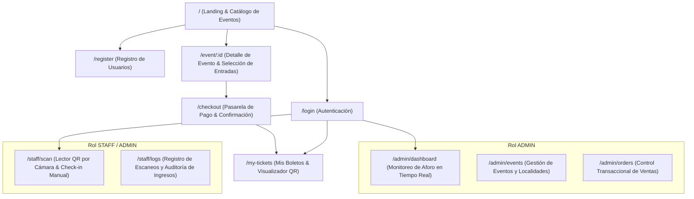

# PassMaster - Mapa de Navegación y Flujos de Usuario

Diagrama y descripción estructural de pantallas, permisos y transiciones del sistema.

---

## 1. Mapa General de Rutas Web

---

## 2. Flujos de Trabajo por Rol

### A. Flujo de Compra (Cliente / Asistente)
1. **Exploración:** El usuario ingresa a la página principal, visualiza los eventos activos con fecha y lugar.
2. **Selección:** Selecciona un evento, revisa las categorías disponibles (`General`, `VIP`), precio y cupos en tiempo real.
3. **Checkout Transaccional:**
   - Selecciona la cantidad de entradas.
   - Si no está autenticado, el sistema solicita inicio de sesión rápido o registro.
   - Ingresa los datos de pago (Tarjeta Stripe o modo Sandbox instantáneo).
4. **Emisión de Boletos:** Tras procesar el pago, se generan los códigos únicos (UUID) y firmas criptográficas HMAC.
5. **Acceso al Boleto:** En la sección "Mis Boletos", el usuario puede ver su boleto digital con el código QR listo para mostrar desde el móvil.

### B. Flujo de Check-in (Personal de Seguridad / Staff)
1. **Acceso Seguro:** El personal inicia sesión con credenciales de rol `STAFF`.
2. **Selección de Evento:** Elige el evento que está controlando en el acceso.
3. **Escaneo de Entrada:**
   - Abre el lector de cámara web/móvil con detección instantánea.
   - Alternativamente, puede ingresar el código de boleto (`TKT-XXXX-XXXX`) de forma manual.
4. **Validación Inmediata:**
   - 🟢 **Pantalla Verde (Válido):** Muestra "ACCESO AUTORIZADO", nombre del asistente y categoría.
   - 🔴 **Pantalla Roja (Rechazado):** Si el boleto ya fue usado, muestra "BOLETO YA REGISTRADO" junto con la hora del primer ingreso para evitar duplicidad de acceso.
   - 🟡 **Pantalla Amarilla (Alerta):** Código no encontrado o firma HMAC adulterada.

### C. Flujo Administrativo (Organizador / Admin)
1. **Monitoreo de Aforo:** Panel con indicadores métricos:
   - Capacidad total vs. Boletos vendidos.
   - Asistentes que ya han ingresado físicamente (Check-in) en tiempo real.
   - Porcentaje de ocupación actual del recinto.
2. **Creación y Edición de Eventos:** Formulario para registrar eventos, fijar fecha, lugar, aforo máximo y configurar múltiples localidades con precios diferenciados.
3. **Auditoría:** Vista global de órdenes y transacciones emitidas.
